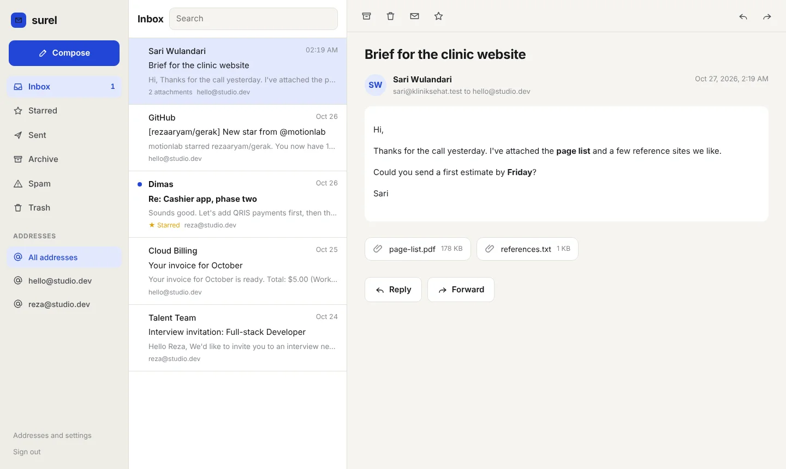

# surel

[](https://github.com/rezaaryam/surel/actions/workflows/test.yml)


**Email on your own domain, running entirely on Cloudflare.** Receive mail for `you@yourdomain.com`, read it in a small web inbox, and reply from the same address. No mail server, no monthly mailbox fee per address.

*Surel* is Indonesian for email (*surat elektronik*).

**[Try the demo inbox](https://rezaaryam.github.io/surel/app/)** (any password works; nothing is sent)



## How it works

```
someone@gmail.com ──▶ Email Routing ──▶ Worker email() ──▶ D1 (messages) + R2 (bodies, attachments)
                                                                     │
you, in the browser ──▶ Worker fetch() ──▶ inbox app + JSON API ◀────┘
                                    └──▶ Email Service (send_email) ──▶ recipient
```

| Part | Cloudflare product | |
|---|---|---|
| Receiving | Email Routing + an Email Worker | every message to your domain reaches the Worker's `email()` handler |
| Storage | D1 and R2 | message rows in D1; bodies, the original `.eml`, and attachments in R2 |
| Sending | Email Service (`send_email` binding) | sends as any of your addresses, with SPF, DKIM, and DMARC set up by Cloudflare |
| Inbox | Workers static assets | a plain HTML/CSS/JS app, no build step |

## Features

- **Several addresses** on one domain (`hello@`, `reza@`, `billing@`), each with its own display name. Turn an address off to reject its mail, or accept every address with `CATCH_ALL`.
- **Read safely.** HTML mail is shown in a sandboxed frame with no scripts and no forms. Remote images (tracking pixels) stay hidden until you click *Show images*. Attachments download with `nosniff` and their own sandbox.
- **Reply, forward, compose** from any of your addresses. A reply is sent from the address the mail came to. Every sent message is kept in *Sent*.
- **Folders**: inbox, starred, sent, archive, spam, trash. Search by sender, subject, or text.
- **Optional copies** to another inbox (`FORWARD_TO`, or per address), and a sender **block list**.
- **Keyboard**: `c` compose, `/` search, `j` `k` next and previous, `e` archive, `#` delete, `r` reply.
- **Phone friendly**, light and dark.
- **One owner, one password.** A Worker secret, a signed `HttpOnly` cookie with `SameSite=Strict`, and JSON-only writes. Put Cloudflare Access in front for a second lock.

## Set up

You need a domain on Cloudflare (its DNS managed by Cloudflare) and Node.js 18 or newer.

```bash
git clone https://github.com/rezaaryam/surel
cd surel
npm install
npx wrangler login
```

1. **Create the storage**
   ```bash
   npx wrangler d1 create surel          # copy the database_id into wrangler.jsonc
   npx wrangler r2 bucket create surel-mail
   ```
2. **Edit `wrangler.jsonc`**: `database_id`, and in `vars` your `DOMAIN`, `DEFAULT_FROM`, and `DEFAULT_NAME`.
3. **Set a password** (stored as a secret, never in the repo)
   ```bash
   npx wrangler secret put SUREL_PASSWORD
   ```
4. **Deploy** (applies the database schema, then uploads the Worker)
   ```bash
   npm run deploy
   ```
5. **Turn on receiving.** In the dashboard: your domain → **Email** → **Email Routing** → enable it, then under **Routing rules** set the **Catch-all** action to *Send to a Worker* → `surel`. (Or add one rule per address.)
6. **Turn on sending.** **Compute** → **Email Service** → **Email Sending** → **Onboard Domain** and choose your domain. Cloudflare adds the SPF, DKIM, DMARC, and bounce records.
7. **Open the inbox** at your Worker's address, or add a custom domain such as `mail.yourdomain.com` under the Worker's **Settings → Domains & Routes**.

Then add your addresses under *Addresses and settings* in the inbox. Until you add one, every address on the domain is accepted.

### Costs and limits

- Receiving with Email Routing is free. D1 and R2 have free tiers that cover a personal inbox.
- **Sending to any recipient needs the Workers Paid plan.** On the free plan the binding can still send to addresses you have verified in Email Routing. Email Sending is in beta: new accounts get a daily quota that Cloudflare raises over time, a message can have up to 50 recipients, and the total size limit is 5 MiB.
- Incoming mail up to 25 MB is accepted. `FORWARD_TO` addresses must be verified in Email Routing first.

## Configuration

| Variable | | |
|---|---|---|
| `DOMAIN` | required | your domain; you can only add and send from addresses on it |
| `DEFAULT_FROM` | required | the address to send from when none is chosen |
| `DEFAULT_NAME` | optional | display name when the address has none |
| `CATCH_ALL` | `"false"` | `"true"` accepts mail to any address on the domain |
| `FORWARD_TO` | `""` | also forward every message here |
| `BLOCK_SENDERS` | `""` | comma separated: `spam@example.com,@annoying.test` |
| `SUREL_PASSWORD` | secret | the inbox password |
| `SESSION_SECRET` | secret, optional | sign sessions with this instead of the password, so changing the password does not need to log you out |

## Develop

```bash
cp .dev.vars.example .dev.vars
npm run db:local
npm run dev
```

`wrangler dev` runs the Worker, D1, and R2 locally. Simulate incoming mail with:

```bash
curl -X POST "http://localhost:8787/cdn-cgi/handler/email?from=a@example.com&to=hello@yourdomain.com" --data-binary @message.eml
```

Sending in local development is simulated and the message is written to a file.

```bash
npm test        # 17 tests
npm run demo    # rebuild the GitHub Pages demo in docs/app
```

The tests run the real Worker code in Node with a D1 stand-in on top of SQLite (the real schema and queries), an R2 stand-in, and a recording `send_email` binding: parsing a multipart message with an attachment, address rules, forwarding, sessions and forged cookies, paging, the HTML sandbox headers, sending and its errors. Browser tests drive the inbox UI on desktop and phone sizes.

## Project layout

```
src/worker.js      entry: email() and fetch()
src/inbound.js     receiving: size and sender checks, address rules, parsing (postal-mime), storing
src/outbound.js    sending through the Email Service binding, validation, the Sent copy
src/store.js       D1 and R2 access
src/api.js         JSON API for the inbox
src/auth.js        password, signed session cookie
public/            the inbox app (HTML, CSS, JS)
migrations/        D1 schema
```

## License

MIT © Reza Arya Maulana. Uses [postal-mime](https://github.com/postalsys/postal-mime) (MIT-0) to parse messages.
